# NEON RAGE · 霓虹怒火

**v0.2.22** · 原创 16-bit 风格横版清关动作游戏，致敬《怒之铁拳》的三人组、街头清版、武器与 Boss 战结构。所有角色、像素画面、关卡与音乐均为程序化原创，不使用原作素材。

## 直接开玩

双击 `neon-rage.html`，或打开 `index.html`（源码版）。推荐 Chrome / Edge / Safari。

如果浏览器限制本地文件音频，可在目录里启动一个静态服务器：

```bash
python3 -m http.server 8000
# 打开 http://localhost:8000
```

声音需要一次点击/按键后才会启动。

修改 `index.html` / `styles.css` / `js/*.js` 后，运行 `node build.js` 重新生成单文件版。

## 操作

| 按键 | 动作 |
| --- | --- |
| `WASD` / 方向键 | 移动、上下走位 |
| `→` `→`（第二下按住） | 跑动；松开后短暂保留冲刺输入窗口 |
| `前前 + J` | 角色专属突进技：火焰崩拳 / 闪电踢 / 烟尘冲撞 |
| `J` / `Z` | 三连击 / 使用手中武器（手枪射击） |
| `K` / `X` | 跳跃；空中再按 `J` 是跳踢 |
| `L` / `C` | 必杀；消耗体力，被围住时用 |
| `↓ ↓ + L` | 超必杀；消耗 1 枚超必杀核心 |
| `E` / `V` | 抓取 / 膝击 / 投掷 / 拾取道具 |
| `Esc` / `P` | 暂停 |
| `M` | 静音（会记住） |

触屏设备会自动显示左侧方向键和右侧「打 / 跳 / 抓 / 必杀」按钮。

## 核心系统

- **单屏封面与设置**：开始游戏旁打开设置页；操作、生存守则、关于与 BGM 均在游戏内设置中。声音页可用 `W/S` 或鼠标切换 BGM，`A/D` 切换分类；音乐/音效音量可分别调节并保存，静音状态也会记住。
- **操作演示**：设置 → 操作内置两段 GIF 演示，分别对应「冲刺技」REX 崩拳突进与「必杀」LUNA 雷光贯线；只在打开该页时加载，离开后停止播放。
- **三组 BGM**：NEON CLASSIC / MIDNIGHT DRIVE / STEEL PULSE，可随时切换并保存；六关 Boss 各有专属战斗曲。BGM 采用 8 小节 A/B/C 编排与加花，Boss 战会随阶段叠加强度层。
- **斗士强化**：移动速度、攻击速度、防御各 3 级；每级吃 3 枚芯片。全场 32 个发光强化油桶，每桶固定 1 枚属性芯片。
- **七波敌人**：每关 6 个普通波 + 1 个 Boss 波；普通波数量随难度、波次和 50% 基础增幅变化。
- **Boss 杂兵**：简单无杂兵，普通 2 个，困难 4 个。
- **角色超必杀**：REX「零号通缉令」、LUNA「雷狱圆舞」、BRUNO「陨星断岳」；下下+L 触发，持续约 3 秒，消耗超必杀核心；释放时在施法位置浮现象征斗士的巨型「法相天地」，约 5 秒后渐隐；REX 为三足金乌（火红线条）、LUNA 为应龙（蓝紫线条）、BRUNO 为禺强（金色线条）；采用半实体体积 + 体积光柱 + 接触阴影 + 湿地倒影的混合渲染。
- **封面与难度**：开屏封面主菜单进入 EASY / NORMAL / HARD；难度影响敌人 HP、玩家受伤和初始生命。
- **Boss 出场对话**：六关 Boss 登场时冻结战斗并播放背景/叫嚣台词，可自动推进或跳过；双子各有一句。
- **三名可选斗士**：REX（均衡）、LUNA（高速）、BRUNO（力量），属性、连击速度、必杀伤害均不同。
- **六关**：第九码头 → 七号轻轨 → V 塔天台 → 霓虹花园 → 顶楼赌场 → V 塔核心。第 4 关是 RAVEN / NYX 双子 Boss，第 5 关是 THE HOUSE 牌桌庄家，第 6 关是 V-PRIME 最终三形态 Boss。
- **十种杂兵**：混混、刀锋、重拳、踢手、拳手（侧闪三连拳）、鞭手（远距离两连鞭）、枪手（后撤射击）、塞壬（腾空飞踢）、蝰蛇（后撤扔飞刀）与摔跤手（抓取过肩摔）。
- **两侧入场**：杂兵会从镜头左右两侧进入战场，部分波次由两翼包夹；双子 Boss 也会一左一右登场。
- **Boss 新招式**：RAZOR 增加大范围横扫剑气；TITAN 增加冲刺撞人、跳跃重砸；VECTOR 增加升龙拳与大型波动拳；THE HOUSE 使用纸牌扇、筹码、轮盘和全押冲锋。
- **Boss 强化**：所有 Boss 的拳脚启动更快、攻击距离更远；普通拳脚的出手间隔再次缩短；V-PRIME 的机枪每发子弹造成 10 点伤害。
- **第 4 关双子 Boss**：RAVEN（瞬移斩、四连刀）与 NYX（飞跃踢、三连旋风腿），两人共用一条警告栏但各自有独立血条。
- **最终 Boss V-PRIME**：第一阶段机枪扫射；第二阶段暴走，获得冲刺重拳与三连重击；第三阶段天翔，悬浮空中、俯冲砸地并发射能量弹。
- **敌人血条**：普通敌人头顶显示分段血条，低血量会变黄并闪烁；Boss 使用屏幕顶部的大血条。
- **连击与输入缓冲**：快速连按也能稳定打出三连；第三段会击倒。
- **跑动**：双击前方向并按住进入跑动，速度约为走路的 2 倍；松开后仍保留约 0.3 秒的冲刺技输入窗口。
- **抓摔**：靠近人形敌人按 `E`，`J` 膝击，`K` 投掷。投出的敌人会撞倒其他打手。
- **必杀按角色分化**：REX「烈焰升龙」大范围火焰上勾；LUNA「雷光贯线」沿前方 X 轴贯穿一条线；BRUNO「裂地重砸」震击周身地面。必杀会消耗体力并短暂无敌。
- **回血道具**：苹果、牛奶、汉堡、牛排，数值各不相同；血量已满时不会误吃。
- **三种武器**：钢管（范围/耐久）、小刀（高速连刺）、手枪（6 发子弹，按 `J` 射击，打空自动丢弃）。
- **角色突进技（前前 + J）**：REX「崩拳突进」裹挟火焰，LUNA「流光踢」拖出闪电与电火花，BRUNO「蛮牛头槌」卷起烟尘与碎屑；三者的伤害、突进距离和命中反馈均不同。
- **高分道具**：现金（+500）、钱袋（+1200）、金条（+3000）；从木箱、精英敌人或关卡角落获得。
- **会掉包的敌人**：枪手有概率掉落 3 发手枪，刀锋/蝰蛇可能掉小刀，拳手可能掉汉堡。
- **破坏物与补给**：木箱/油桶会掉落现金、回血道具或武器；每波清场也可能出现补给。
- **街机反馈**：受击停顿、屏幕震动、元素粒子、伤害数字、连击计数、CRT 扫描线与 Synthesizer 配乐。
- **最佳分数** 会保存在浏览器本地。

## 文件

```
index.html          页面结构
styles.css          街机外壳、HUD、标题与触屏 UI
js/audio.js         Web Audio 合成器：关卡/Boss/双子/最终战循环曲 + 音效
js/art.js           程序化像素角色、动画、背景与关卡视差
js/game.js          游戏循环、角色/敌人 AI、战斗、波次、结算
build.js            将样式、脚本与难度背景图内联成单文件版
neon-rage.html      内联全部资源的单文件版（便于分享）
images/             难度与斗士选择卡片的背景图
screenshots/        关卡、Boss、招式与移动端截图
```

## 截图

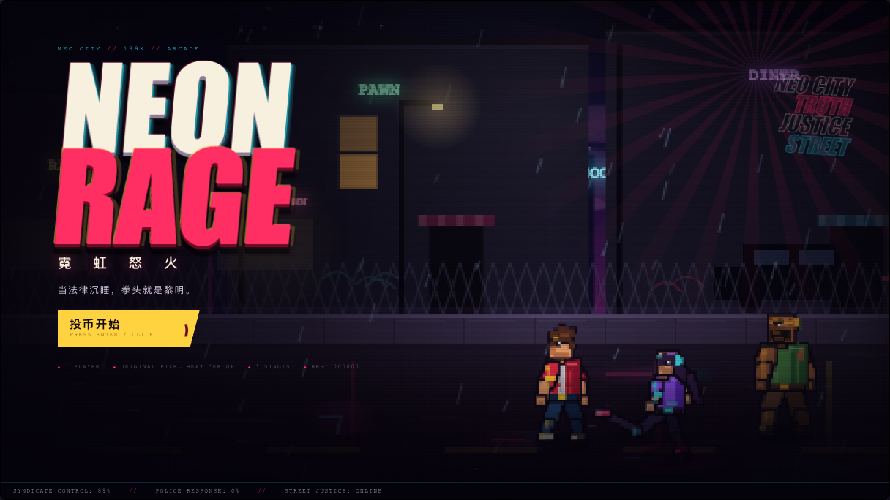

| 第 4 关双子 Boss | 最终 Boss 第三形态 |
| --- | --- |
| 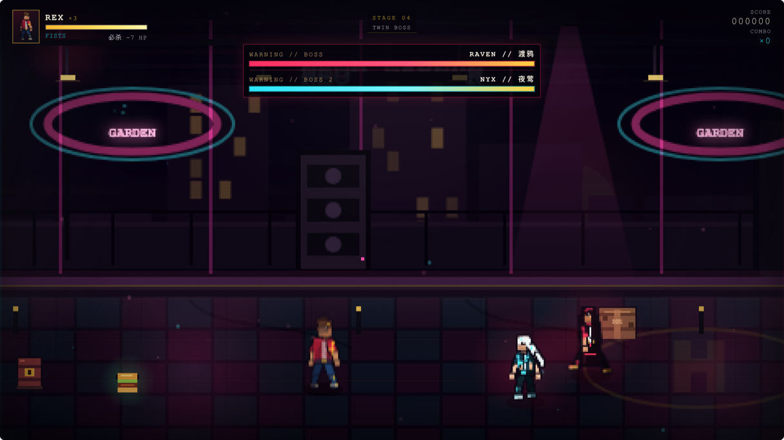 | 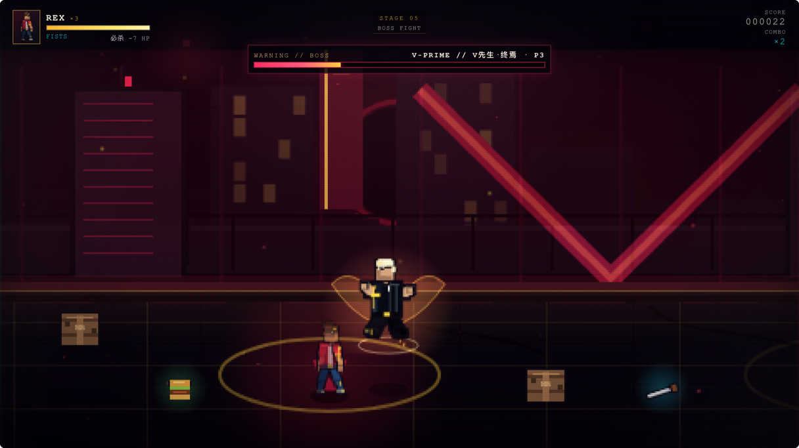 |

| RAZOR 横扫 | 摔跤手过肩摔 |
| --- | --- |
| 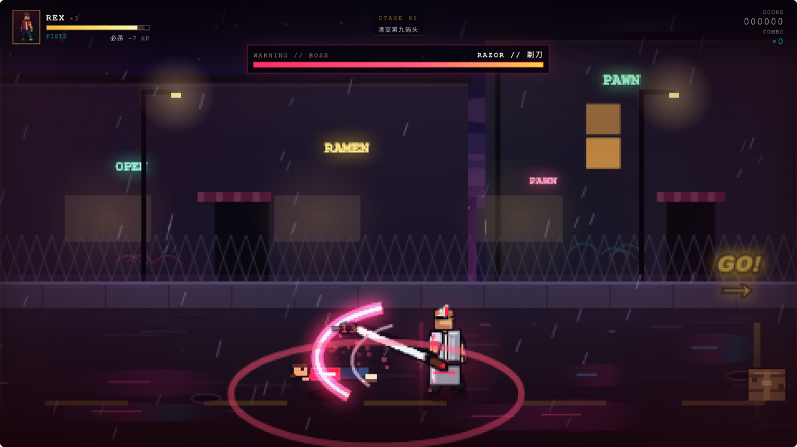 | 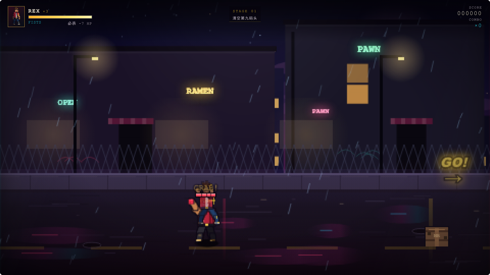 |

| REX 烈焰升龙 | LUNA 雷光贯线 |
| --- | --- |
| 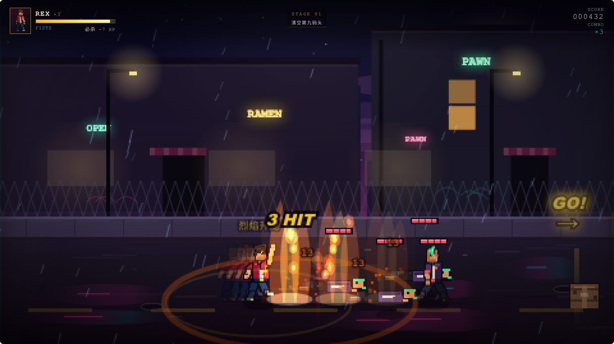 | 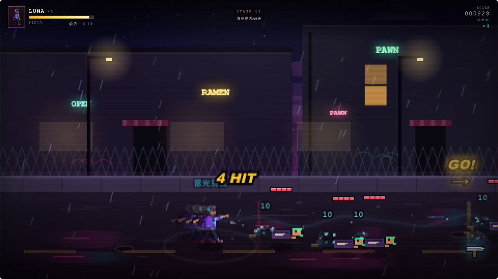 |

| BRUNO 裂地重砸 | BRUNO 蛮牛头槌 |
| --- | --- |
| 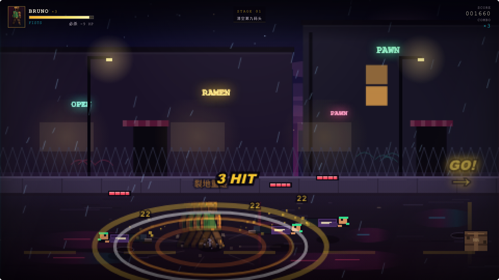 | 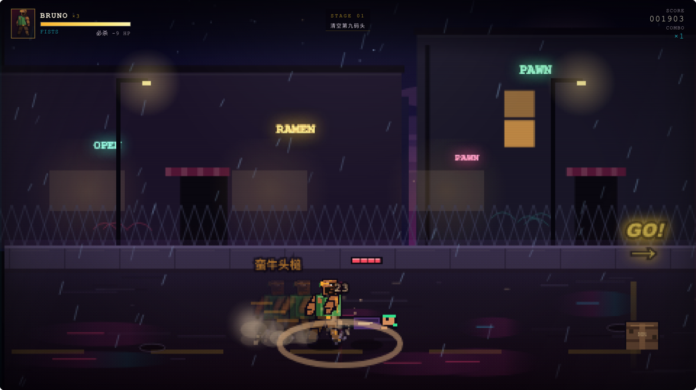 |

| 游戏封面 | 难度选择 |
| --- | --- |
| 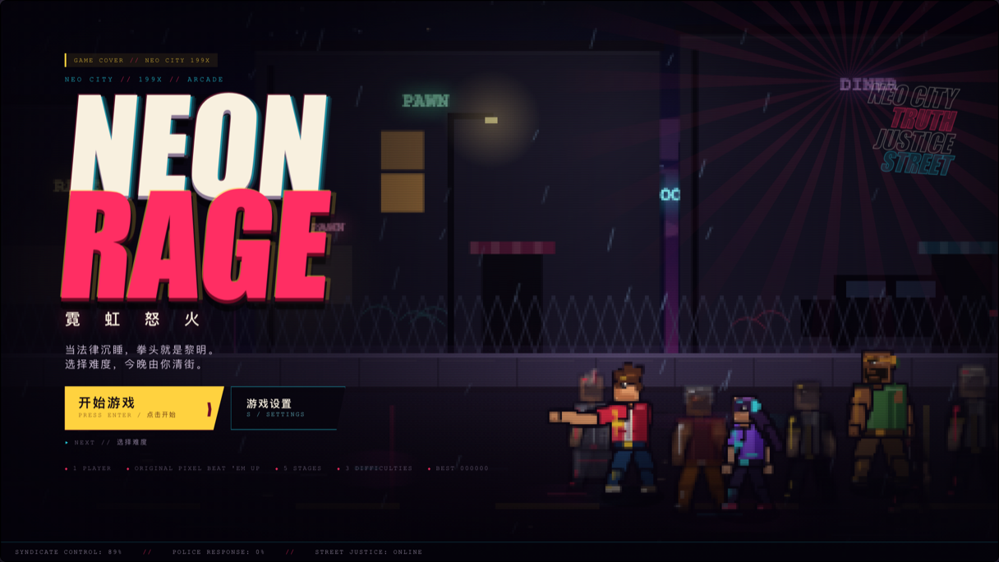 | 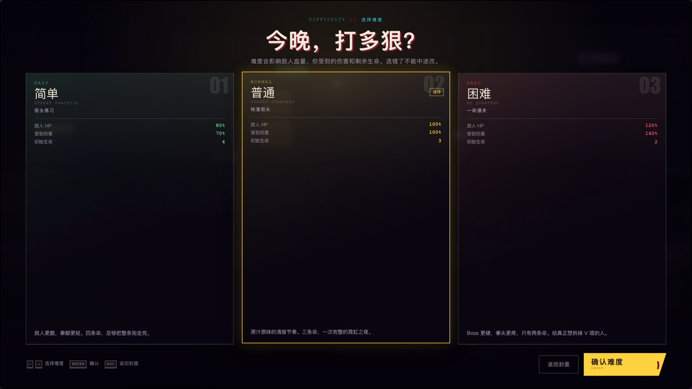 |

| 游戏设置 | 斗士强化油桶 |
| --- | --- |
| 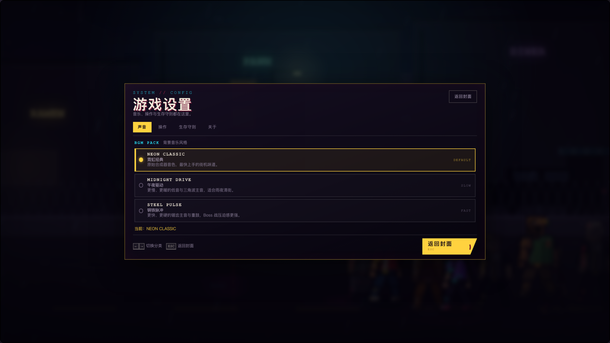 | 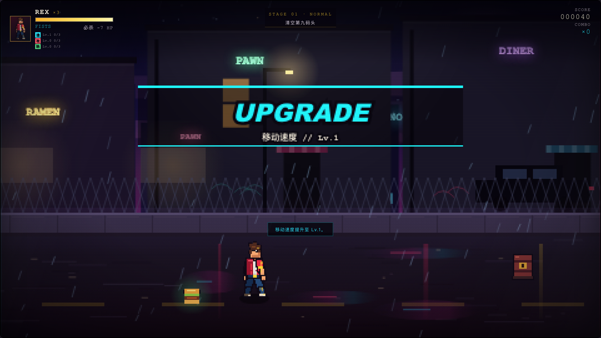 |

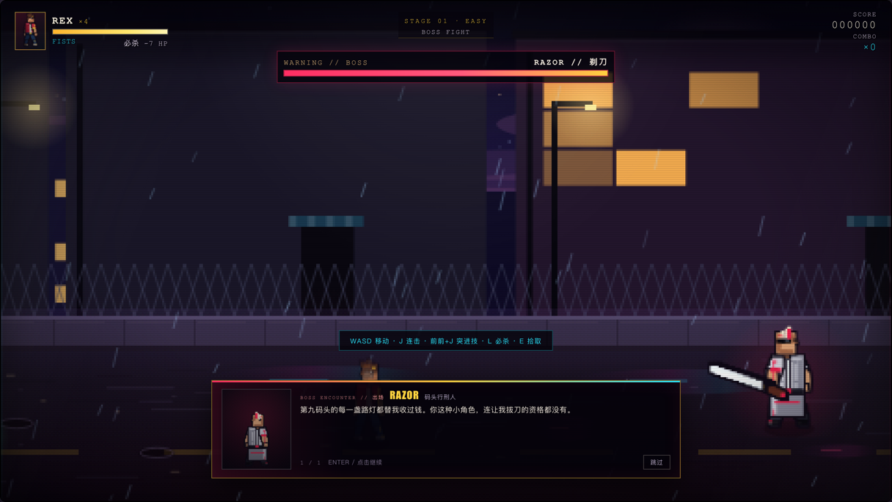

## 说明

- 本作是非商业同人作品，与 SEGA 及相关权利人无关联。
- `Streets of Rage` / `怒之铁拳` 相关商标归其权利人所有。
